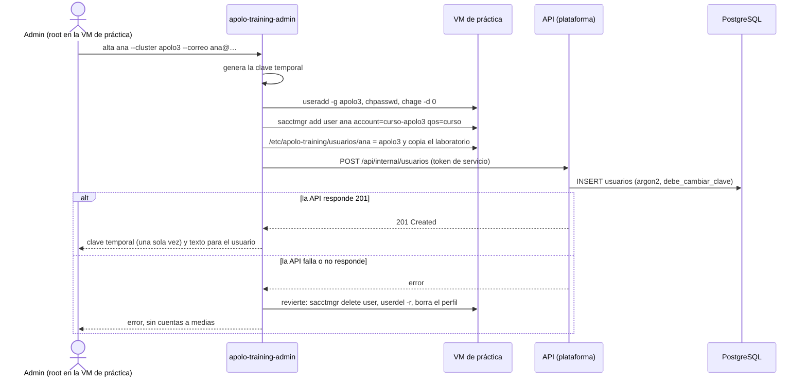
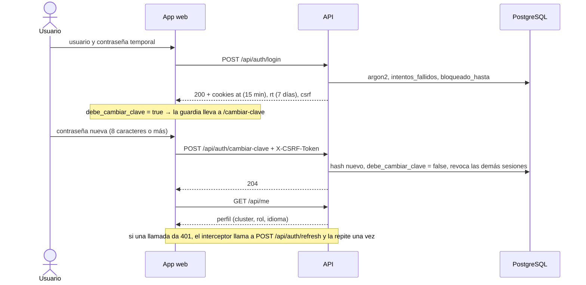
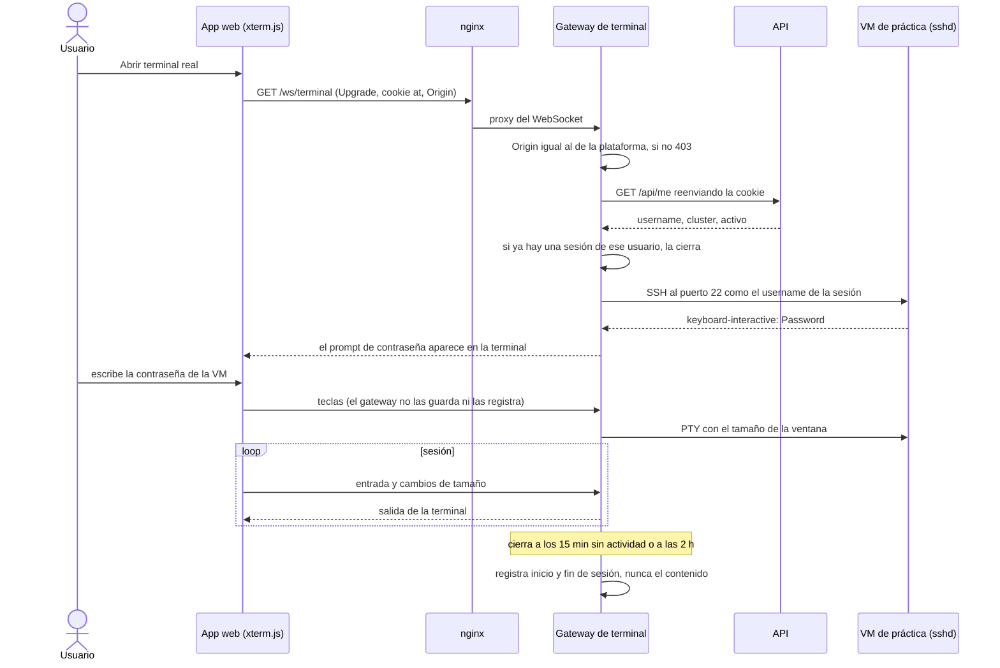
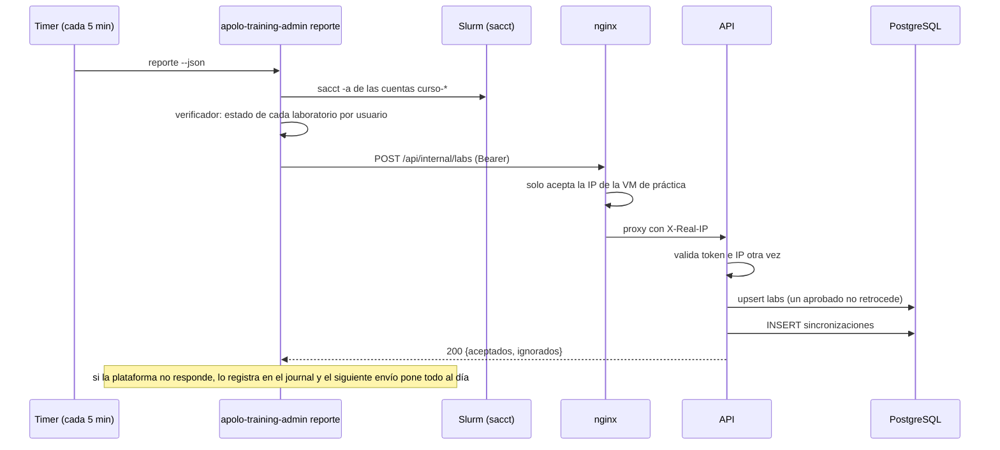
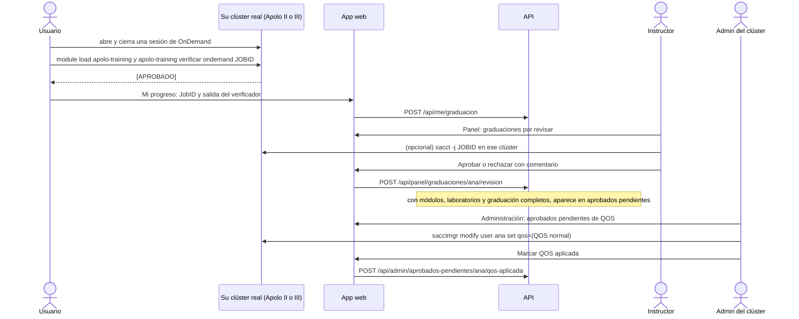
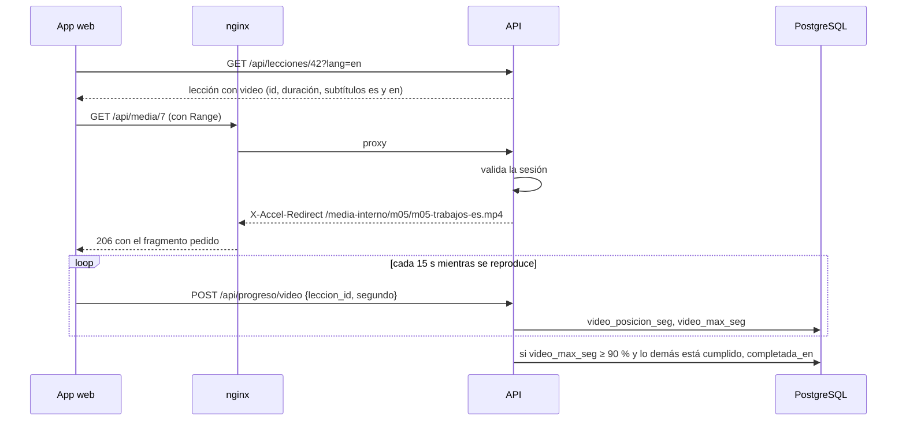

# Flujos

Cómo se mueven los datos entre el navegador, la plataforma (VM 117) y la VM de
práctica (VM 116). Las rutas de la API están en
[`api/openapi.yaml`](../../api/openapi.yaml); aquí va el orden de los pasos y lo
que OpenAPI no describe (el WebSocket de la terminal y el reporte de
laboratorios).

Nombres usados en los diagramas: **plataforma** es la VM 117 (nginx, api,
terminal y db en Docker Compose) y **VM de práctica** es la 116. Las IPs no se
escriben aquí porque el repo será público; están en el inventario cifrado de
Ansible.

## 1. Alta de una cuenta

Una sola orden crea al usuario en los dos lados. Se corre como root en la VM
de práctica porque ahí hay que crear la cuenta Unix y la asociación de Slurm;
la plataforma no tiene acceso de root a esa VM, y es mejor que no lo tenga.



- La **baja** sigue el mismo camino: `apolo-training-admin baja ana` bloquea la
  cuenta Unix, quita la asociación de Slurm y llama a
  `PATCH /api/internal/usuarios/ana` con `{"activo": false}`, que revoca sus
  sesiones. El home se archiva a los 30 días (V-04).
- Desde el panel web **no** se crean ni se borran cuentas: el botón «Nuevo
  usuario» muestra la orden para copiar. Si se crearan desde la web, quedaría
  un usuario en la plataforma sin cuenta en la VM y la terminal real fallaría.
- **Son dos contraseñas** que empiezan iguales: la de la plataforma y la de la
  VM. Cada una se cambia en su primer ingreso y desde ahí son independientes.
  El módulo 1 lo explica, y el reinicio de clave del panel solo cambia la de la
  plataforma (la de la VM se reinicia con `apolo-training-admin`).

## 2. Inicio de sesión y primer ingreso



- **Cookies.** `at` (token de acceso, 15 min) y `rt` (refresh, 7 días, solo en
  `/api/auth`) son `HttpOnly`, `Secure` y `SameSite=Strict`. `csrf` es legible
  por la app y se devuelve en la cabecera `X-CSRF-Token` en todo lo que no sea
  `GET` (doble envío ligado a la sesión, B-03: es un HMAC del id de la sesión,
  así que una cookie `csrf` plantada por otro sitio no sirve).
- **Renovación.** Cada `POST /api/auth/refresh` rota `rt` y cuenta los 7 días
  otra vez. Un `rt` ya rotado que llega en los 30 s siguientes (otra pestaña)
  no cambia nada; si llega después, se cierran todas las sesiones del usuario.
- **Bloqueo.** Al quinto intento fallido, 15 minutos de bloqueo y el contador
  vuelve a 0. Un usuario inexistente recibe lo mismo que una clave errada.
- **Errores con código.** La API responde `{"detail": "...", "codigo": "..."}` y
  la app traduce el `codigo` con Transloco (`clave_incorrecta`,
  `cuenta_bloqueada`, `debe_cambiar_clave`…). Así los mensajes salen en el
  idioma de la interfaz sin que la API sepa de idiomas.
- Mientras `debe_cambiar_clave` sea `true`, todo salvo `/api/auth/*`,
  `GET /api/me` y `PATCH /api/me` responde 403 con `codigo = debe_cambiar_clave`.
- **En la app (F-03).** Al arrancar, si no hay cookie `csrf` no hay sesión y no
  se llama a la API; si la hay, `GET /api/me` trae el perfil y su idioma. Las
  guardias llevan a `/ingresar?volver=…` sin sesión, a `/cambiar-clave` con la
  clave temporal y a `/cursos` a quien abre Panel o Administración sin su rol.
  El interceptor renueva una sola vez aunque fallen varias peticiones a la vez;
  si la renovación falla, lleva a `/ingresar` con «Tu sesión terminó».
- **Olvidé mi contraseña:** en la v0 no hay correo saliente, así que la pantalla
  indica escribir a soporte y un instructor la reinicia desde el panel.

## 3. Terminal real

El gateway (contenedor `terminal`, T-05) solo sabe abrir SSH hacia la VM de
práctica, con el usuario de la sesión. El navegador no puede elegir host ni
usuario.



**Validar la sesión con `GET /api/me`** (propuesta para la T-05): el gateway no
necesita la llave de los JWT ni una ruta nueva; le pregunta a la API con la
misma cookie del usuario. Como las cookies son `SameSite=Strict` y el gateway
valida el `Origin`, otro sitio no puede abrir el WebSocket a nombre del usuario.
Si el token de acceso venció, la app hace `refresh` antes de conectar.

**Mensajes del WebSocket** (contrato entre T-05 y T-06):

| Dirección           | Marco   | Contenido                                                          |
| ------------------- | ------- | ------------------------------------------------------------------ |
| navegador → gateway | texto   | `{"tipo": "entrada", "datos": "ls -l\r"}`                          |
| navegador → gateway | texto   | `{"tipo": "tamano", "columnas": 120, "filas": 32}`                 |
| gateway → navegador | binario | bytes de salida de la terminal, tal cual                           |
| gateway → navegador | texto   | `{"tipo": "estado", "estado": "conectado"}`                        |
| gateway → navegador | texto   | `{"tipo": "estado", "estado": "cerrado", "motivo": "inactividad"}` |

Motivos de cierre: `inactividad`, `tiempo_maximo`, `otra_sesion`,
`ssh_rechazado`, `sesion_invalida`, `error`. La app los traduce y ofrece
reconectar.

## 4. Sincronización de laboratorios



**Formato del reporte** (lo produce la V-05 y lo recibe la B-07):

```json
{
  "generado_en": "2026-11-26T10:05:00-05:00",
  "registros": [
    {
      "usuario": "ana",
      "lab": "memoria",
      "estado": "aprobado",
      "jobid": "1042",
      "fecha": "2026-11-26T09:58:12-05:00",
      "detalle": "Terminó con --mem=4G después de OUT_OF_MEMORY con 1G"
    }
  ]
}
```

- `lab`: `modulos`, `memoria`, `nucleos` o `paralelo`. `estado`: `intentado` o
  `aprobado`.
- El reporte es **completo**, no incremental: trae el mejor estado de cada
  laboratorio de cada usuario. Así, si un envío se pierde, el siguiente lo
  corrige, y enviar el mismo reporte dos veces no cambia nada.
- Un usuario que no existe en la plataforma se devuelve en `ignorados` con el
  motivo; no rompe el resto del envío.

## 5. Graduación y QOS

La graduación ocurre en el clúster real del usuario, que no puede enviar nada a
la plataforma. Por eso el usuario trae el resultado a mano y un instructor lo
revisa.



## 6. Video y progreso



- Los subtítulos en inglés se activan solos si la interfaz está en inglés (F-05)
  y se pueden apagar.
- El reporte cada 15 s pasa por el interceptor, así que también mantiene viva la
  cookie de acceso mientras el video corre.

## 7. Carga del contenido

`training import-content` (B-04) lee `content/es` y `content/en`, valida cada
archivo con los esquemas de pydantic y del formato de terminal (T-01) y hace
upsert por `slug` y `clave`. Se corre en el despliegue (W-06), después de
`alembic upgrade head`. Nunca borra progreso; una lección que desaparece del
repo queda despublicada, no borrada.
