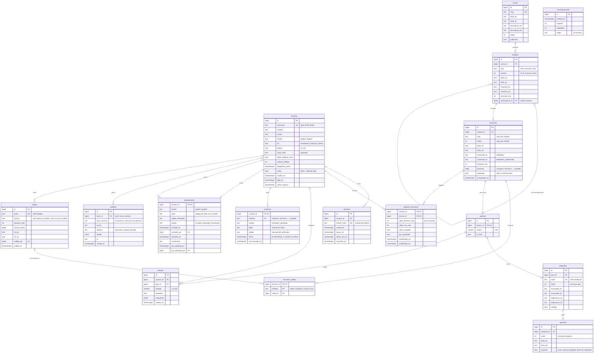

# Modelo de datos

Tablas de PostgreSQL 16 que implementa la B-02, en `api/app/models/` y la
primera migración de `api/migrations/versions/`. Este diagrama y los modelos
tienen que coincidir: lo revisa `api/tests/test_diagrama.py`. Si cambia un
modelo, se cambia este archivo en el mismo PR.

## Diagrama entidad-relación

`sincronizaciones` no tiene relaciones: es el registro de cada envío de la VM
de práctica y de ahí sale la «última sincronización» de Mi progreso.

## Tablas

### Personas y sesiones

**usuarios.** Una fila por persona. `username` es el mismo de su cuenta en el
clúster y también el de la VM de práctica; por eso es único, no se cambia y
sigue el mismo patrón que `Username` en `api/openapi.yaml`. `cluster` decide el
perfil de la VM (`docs/perfiles.md`) y la pestaña que se abre por defecto en
las lecciones. Una baja no borra la fila: pone `activo = false` y `baja_en`
(un `CHECK` exige las dos cosas juntas), para conservar el progreso y la
auditoría.

- Bloqueo: `intentos_fallidos` llega a 5 → `bloqueado_hasta = ahora + 15 min`
  y vuelve a 0 (B-03); también vuelve a 0 al entrar bien.
- `debe_cambiar_clave` empieza en `true` y la API solo deja usar `/auth/*`,
  `GET /me` y `PATCH /me` hasta que se cambie.

**sesiones.** Una fila por refresh token emitido. Se guarda solo el hash, nunca
el token. Sirve para cerrar sesión de verdad (logout, cambio de clave, baja o
reinicio de clave revocan todas las sesiones del usuario). Cada renovación
revoca la fila y crea otra (B-03): el token de acceso lleva el `id` de la
fila, y el token CSRF sale de ese mismo `id`. Se borran las vencidas con una
tarea diaria.

### Contenido

El contenido vive en `content/` del repo y lo carga `python -m app.importar`
(B-04). El curso sale de `content/es/_curso.md` (su `id` es `cursos.slug`). El importador busca por `slug` o `clave`, así que importar dos veces no
duplica filas y el progreso de los usuarios no se pierde. Los `orden` únicos
(lecciones, preguntas y opciones) son **diferibles**: se revisan al confirmar
la transacción, para que el importador pueda reordenar sin chocar a mitad de
camino.

**cursos, modulos, lecciones.** Hoy hay un curso con nueve módulos (0 a 8,
`content/mapa.md`). `modulos.slug` es el `id` del front matter del módulo
(`m05`) y `lecciones.slug` el nombre de la lección (`trabajos` en
`m05/trabajos`). `modulos.prerrequisito_id` apunta al módulo anterior; el
siguiente se abre cuando todas las lecciones del anterior están completas.

Una lección no tiene un `tipo` fijo: trae lo que diga su front matter (C-01):
videos, prácticas de la VM (`practicas`, una lista: `m06/paralelismo` tiene
`nucleos` y `paralelo`) y quiz. Se completa cuando cumple todo lo que trae:

| Si la lección trae…             | …se cumple cuando                           |
| ------------------------------- | ------------------------------------------- |
| video                           | `video_max_seg` ≥ 90 % de la duración       |
| quiz                            | un intento con 80 % o más (`quiz_aprobado`) |
| solo texto, o texto y prácticas | el usuario pulsa «Marcar como completada»   |

Las prácticas **no** bloquean la lección ni el módulo siguiente: su resultado
llega desde la VM cada 5 minutos y cuenta para aprobar el curso, no para
navegar.

**videos.** Una fila por video, identificada por `clave` (`m05-trabajos`), con
el patrón de `ClaveVideo` del contrato. El importador crea la fila sin archivo
y el instructor sube el MP4 y los VTT desde el panel con esa clave. Mientras no
haya archivo, la lección muestra «Video pendiente». Las rutas son relativas a
`/srv/apolo-training/media`.

**lecciones_videos.** Qué video se muestra en cada lección. Casi siempre es
uno, con `sistema = 'todos'`. En la lección de VPN (`m01/vpn`) hay uno por
sistema operativo (`windows`, `macos`, `linux`) y la plataforma muestra el del
usuario. Una lección no mezcla `todos` con los de un sistema: lo revisa el
importador, que también rechaza un front matter con un solo sistema.

**quizzes, preguntas, opciones.** Un quiz pertenece a una lección y se
identifica por ella (`leccion_id` único). El quiz final (8 preguntas, en
`m08/cierre`) tiene `es_final = true`. `preguntas.clave` es única en todo el
curso y no cambia aunque cambie el texto, así se conservan los intentos. Los
textos van en los dos idiomas; si falta el inglés, la API devuelve el español
con `fallback = true`. La columna `opciones.correcta` nunca se envía al
navegador antes de que el usuario responda (B-06).

### Progreso

**intentos.** Cada envío de un quiz, con las respuestas en `jsonb`
(`{"<pregunta_id>": [<opcion_id>, ...]}`) y el puntaje calculado en el servidor.
Intentos ilimitados; cuenta el mejor.

**progreso_lecciones.** Una fila por usuario y lección, creada en el primer
reporte. `video_posicion_seg` es donde se reanuda; `video_max_seg` es lo más
lejos que llegó. `completada_en` se llena una sola vez.

**practicas.** El último estado conocido de cada una de las siete prácticas del
verificador por usuario, tal como lo envía la VM de práctica (V-05). Solo las
de Slurm (`modulos`, `memoria`, `nucleos`, `paralelo`) traen `jobid`. Regla del
upsert: un `aprobado` nunca se reemplaza por un `intentado` posterior. Si no
hay fila, la pantalla muestra «sin intentar».

**sincronizaciones.** Un registro por cada envío de la VM, aunque no traiga
cambios. Si el último tiene más de 15 minutos, Mi progreso avisa (F-07).

**graduaciones.** Una por usuario. La graduación es un trabajo por lotes en su
clúster real (`m07/graduacion`, V-07): el estudiante envía el JobID y la salida
de `apolo-training verificar graduacion JOBID`; un instructor la aprueba o la
rechaza con un comentario. Si la rechaza, el siguiente envío reemplaza la fila.
Cuando un admin aplica la QOS normal en el clúster real, marca
`qos_aplicada_en`.

### Auditoría

**auditoria.** Solo agrega filas. Acciones previstas: `login_ok`,
`login_fallido`, `cuenta_bloqueada`, `cambio_clave`, `reuso_refresh`, `alta`,
`baja`, `reinicio_clave`, `cambio_rol`, `video_subido`, `graduacion_enviada`,
`graduacion_revisada`, `qos_aplicada`, `sincronizacion_rechazada`. Nunca guarda
contraseñas, tokens ni lo que se escribe en una terminal. Un `login_fallido`
con un usuario que no existe no guarda lo que se escribió (podría ser la clave
en el campo equivocado).

## Cuándo se aprueba el curso

Un usuario aparece en «aprobados pendientes de QOS» cuando cumple las tres
condiciones:

1. Todas las lecciones de los nueve módulos completas (incluye el quiz final
   con 80 % o más).
2. Las siete prácticas en `aprobado`.
3. La graduación en `aprobada`.

Es una consulta, no una columna: no hay un estado «aprobado» guardado que se
pueda desincronizar.

## Índices y restricciones

| Tabla                | Índice o restricción                                                       |
| -------------------- | -------------------------------------------------------------------------- |
| usuarios             | `username` único y con patrón; índice en `(cluster, activo)`; `CHECK` baja |
| sesiones             | `refresh_hash` único; índice en `usuario_id`                               |
| modulos              | único `(curso_id, slug)`; único `(curso_id, numero)`                       |
| lecciones            | único `(modulo_id, slug)`; único diferible `(modulo_id, orden)`            |
| lecciones_videos     | PK `(leccion_id, sistema)`; índice en `video_id`                           |
| quizzes              | `leccion_id` único                                                         |
| preguntas            | `clave` única; único diferible `(quiz_id, orden)`                          |
| opciones             | único diferible `(pregunta_id, orden)`                                     |
| intentos             | índice en `(usuario_id, quiz_id)`                                          |
| progreso_lecciones   | PK `(usuario_id, leccion_id)`; índice en `leccion_id`                      |
| practicas            | PK `(usuario_id, practica)`                                                |
| graduaciones         | PK `usuario_id`; índice en `estado`                                        |
| sincronizaciones     | índice en `recibida_en`                                                    |
| auditoria            | índices en `creado_en` y `actor_id`                                        |
| todas las de estados | `CHECK` con los valores permitidos (en vez de tipos `ENUM`)                |

Se usan `CHECK` en vez de `ENUM` de PostgreSQL porque agregar un valor a un
`ENUM` complica las migraciones de Alembic. Los valores están en
`api/app/models/valores.py`; si cambia una lista, la migración nueva borra y
vuelve a crear el `CHECK` de esa columna. Los ids son `bigint` con
`GENERATED BY DEFAULT AS IDENTITY`.

## Datos de ejemplo

`python -m app.datos_ejemplo` crea cinco usuarios para el entorno de
desarrollo (cada rol y cada clúster, uno que debe cambiar la clave y uno dado
de baja). Lo corre el servicio `migrar` de `deploy/compose.dev.yaml` y se niega
a correr sin `API_DATOS_EJEMPLO=true`. Usuarios y clave en `deploy/README.md`.

## Cambios frente a la A-11

Aplicados en la B-02 por las decisiones posteriores al diseño (A-12, C-01,
OnDemand fuera del curso, P-01):

- **Sin terminal quemada:** sale `lecciones.escenario` y
  `progreso_lecciones.terminal_completa`.
- **`lecciones.lab` pasa a `lecciones.practicas`, una lista,** y la tabla
  `labs` pasa a **`practicas`**, con las siete prácticas del verificador (no
  solo las cuatro de Slurm). Se usa «práctica» como en el front matter, el
  verificador y el glosario, que reserva «laboratorio» para las de Slurm.
- **`lecciones.video_id` pasa a la tabla `lecciones_videos`,** para el video
  por sistema operativo de la lección de VPN.
- **Graduación por lotes** en el clúster real, sin OnDemand.
- **`quizzes.clave` sale:** el front matter no la tiene; un quiz se identifica
  por su lección.
- **Nueve módulos (0 a 8)** y quiz final de **8** preguntas.

El contrato (`api/openapi.yaml`: `LabId`, `/api/internal/labs`, `escenario` y
la terminal) y `flujos.md` se alinean en el PR de ajuste del diseño.
