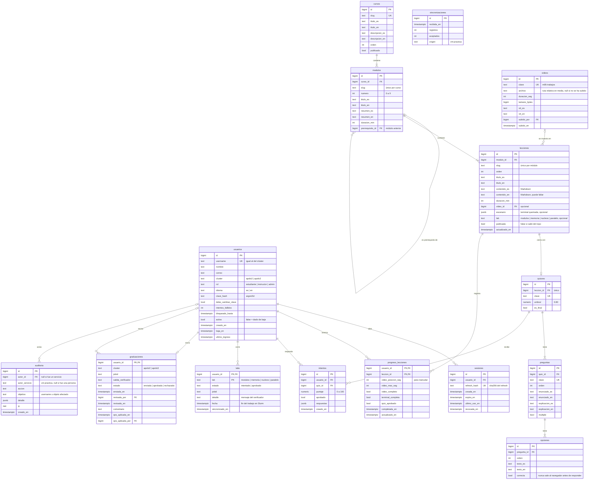

# Modelo de datos

Tablas de PostgreSQL 16 que implementa la B-02. La B-02 se cierra cuando los
modelos de SQLAlchemy coinciden con este diagrama; si cambian, se actualiza
este archivo en el mismo PR.

## Diagrama entidad-relación

`sincronizaciones` no tiene relaciones: es el registro de cada envío de la VM
de práctica y de ahí sale la «última sincronización» de Mi progreso.

## Tablas

### Personas y sesiones

**usuarios.** Una fila por persona. `username` es el mismo de su cuenta en el
clúster y también el de la VM de práctica; por eso es único y no se cambia.
`cluster` decide el perfil de la VM y la pestaña que se abre por defecto en las
lecciones. Una baja no borra la fila: pone `activo = false` y `baja_en`, para
conservar el progreso y la auditoría.

- Bloqueo: `intentos_fallidos` llega a 5 → `bloqueado_hasta = ahora + 15 min`
  y se reinicia a 0 al entrar bien (B-03).
- `debe_cambiar_clave` empieza en `true` y la API solo deja usar `/auth/*` y
  `GET /me` hasta que se cambie.

**sesiones.** Una fila por refresh token emitido. Se guarda solo el hash, nunca
el token. Sirve para cerrar sesión de verdad (logout, cambio de clave, baja o
reinicio de clave revocan todas las sesiones del usuario). Se borran las
vencidas con una tarea diaria.

### Contenido

El contenido vive en `content/` del repo y lo carga `training import-content`
(B-04). El importador busca por `slug` o `clave`, así que importar dos veces no
duplica filas y el progreso de los usuarios no se pierde.

**cursos, modulos, lecciones.** Hoy hay un curso con diez módulos (0 a 9).
`modulos.prerrequisito_id` apunta al módulo anterior; el siguiente se abre
cuando todas las lecciones del anterior están completas.

Una lección no tiene un `tipo` fijo: puede traer cualquier combinación de
video, lectura, terminal quemada, laboratorio y quiz, igual que la plantilla de
la C-01. Se completa cuando cumple todo lo que trae:

| Si la lección trae… | …se cumple cuando                                       |
| ------------------- | ------------------------------------------------------- |
| video               | `video_max_seg` ≥ 90 % de la duración                   |
| terminal quemada    | el escenario llega al último paso (`terminal_completa`) |
| quiz                | un intento con 80 % o más (`quiz_aprobado`)             |
| solo lectura o lab  | el usuario pulsa «Marcar como completada»               |

El laboratorio **no** bloquea la lección ni el módulo siguiente: su resultado
llega desde la VM cada 5 minutos y cuenta para aprobar el curso, no para
navegar.

**videos.** Una fila por video, identificada por `clave` (`m01-conexion`,
`m04-modulos`, `m05-trabajos`, `m06-paralelismo`, `m07-ondemand`). El front
matter de la lección dice `video: m05-trabajos`; el importador crea la fila sin
archivo y el instructor sube el MP4 y los VTT desde el panel con esa clave.
Mientras no haya archivo, la lección muestra «Video pendiente». Las rutas son
relativas a `/srv/apolo-training/media`.

**quizzes, preguntas, opciones.** Un quiz pertenece a una lección (el quiz del
módulo va en su última lección; el quiz final de 15 preguntas tiene
`es_final = true`). Los textos van en los dos idiomas; si falta el inglés, la
API devuelve el español con `fallback = true`. La columna `opciones.correcta`
nunca se envía al navegador antes de que el usuario responda (B-06).

### Progreso

**intentos.** Cada envío de un quiz, con las respuestas en `jsonb`
(`{"<pregunta_id>": [<opcion_id>, ...]}`) y el puntaje calculado en el servidor.
Intentos ilimitados; cuenta el mejor.

**progreso_lecciones.** Una fila por usuario y lección, creada en el primer
reporte. `video_posicion_seg` es donde se reanuda; `video_max_seg` es lo más
lejos que llegó. `completada_en` se llena una sola vez.

**labs.** El último estado conocido de cada laboratorio por usuario, tal como lo
envía la VM de práctica (V-05). Regla del upsert: un `aprobado` nunca se
reemplaza por un `intentado` posterior. Si no hay fila, la pantalla muestra
«sin intentar».

**sincronizaciones.** Un registro por cada `POST /api/internal/labs`, aunque no
traiga cambios. Si el último tiene más de 15 minutos, Mi progreso avisa (F-07).

**graduaciones.** Una por usuario. El estudiante envía el JobID de su sesión de
OnDemand en el clúster real y la salida de `apolo-training verificar ondemand`;
un instructor la aprueba o la rechaza con un comentario. Cuando un admin aplica
la QOS normal en el clúster real, marca `qos_aplicada_en`.

### Auditoría

**auditoria.** Solo agrega filas. Acciones previstas: `login_ok`,
`login_fallido`, `cuenta_bloqueada`, `cambio_clave`, `alta`, `baja`,
`reinicio_clave`, `cambio_rol`, `video_subido`, `graduacion_enviada`,
`graduacion_revisada`, `qos_aplicada`, `sincronizacion_rechazada`. Nunca guarda
contraseñas, tokens ni el contenido de las terminales.

## Cuándo se aprueba el curso

Un usuario aparece en «aprobados pendientes de QOS» cuando cumple las tres
condiciones:

1. Todas las lecciones de los diez módulos completas (incluye el quiz final con
   80 % o más).
2. Los cuatro laboratorios en `aprobado`.
3. La graduación en `aprobada`.

Es una consulta, no una columna: no hay un estado «aprobado» guardado que se
pueda desincronizar.

## Índices y restricciones

| Tabla                | Índice o restricción                                        |
| -------------------- | ----------------------------------------------------------- |
| usuarios             | `username` único; índice en `(cluster, activo)`             |
| sesiones             | `refresh_hash` único; índice en `usuario_id`                |
| modulos              | único `(curso_id, slug)`; único `(curso_id, numero)`        |
| lecciones            | único `(modulo_id, slug)`; único `(modulo_id, orden)`       |
| quizzes              | `leccion_id` único                                          |
| intentos             | índice en `(usuario_id, quiz_id)`                           |
| progreso_lecciones   | PK `(usuario_id, leccion_id)`; índice en `leccion_id`       |
| labs                 | PK `(usuario_id, lab)`; `CHECK` de `lab` y `estado`         |
| graduaciones         | PK `usuario_id`; índice en `estado`                         |
| auditoria            | índices en `creado_en` y `actor_id`                         |
| todas las de estados | `CHECK` con los valores permitidos (en vez de tipos `ENUM`) |

Se usan `CHECK` en vez de `ENUM` de PostgreSQL porque agregar un valor a un
`ENUM` complica las migraciones de Alembic.

## Diferencias con la B-02 del plan

Para revisar en este PR; si se aprueban, se actualiza la tarjeta de la B-02.

- **`lecciones.tipo` pasa a componentes opcionales** (`video_id`, `escenario`,
  `lab` y el quiz asociado), porque la plantilla de la C-01 pone video, lectura,
  terminal y quiz en la misma lección.
- **Tablas nuevas:** `sesiones` (la B-03 necesita revocar refresh tokens),
  `quizzes` (agrupa las preguntas y da el `{id}` de `/api/quizzes/{id}`) y
  `sincronizaciones` (la F-07 necesita la hora de la última sincronización).
- **`videos` se identifica por `clave`**, para que el contenido del repo y la
  subida desde el panel se encuentren sin depender de ids de la base.
- Nombres en plural (`progreso_lecciones`, `graduaciones`) para que todas las
  tablas sigan la misma regla.
