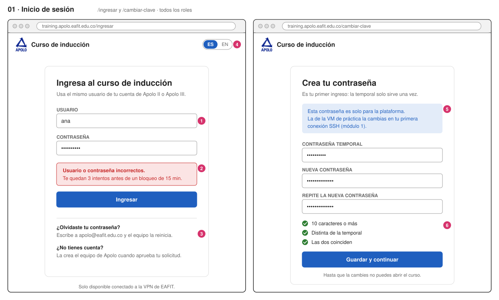
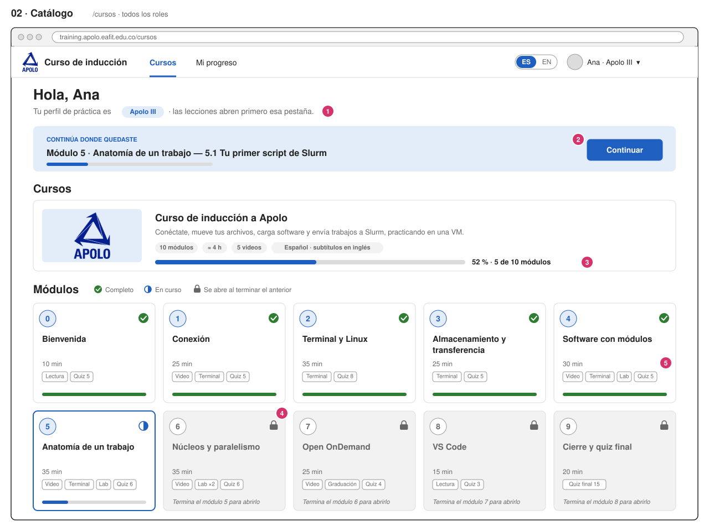
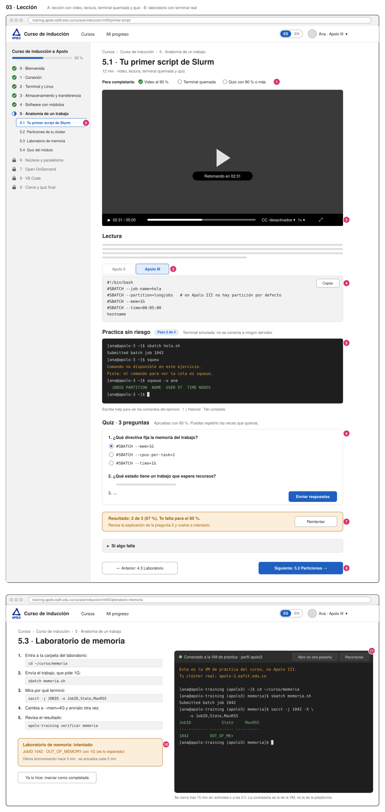
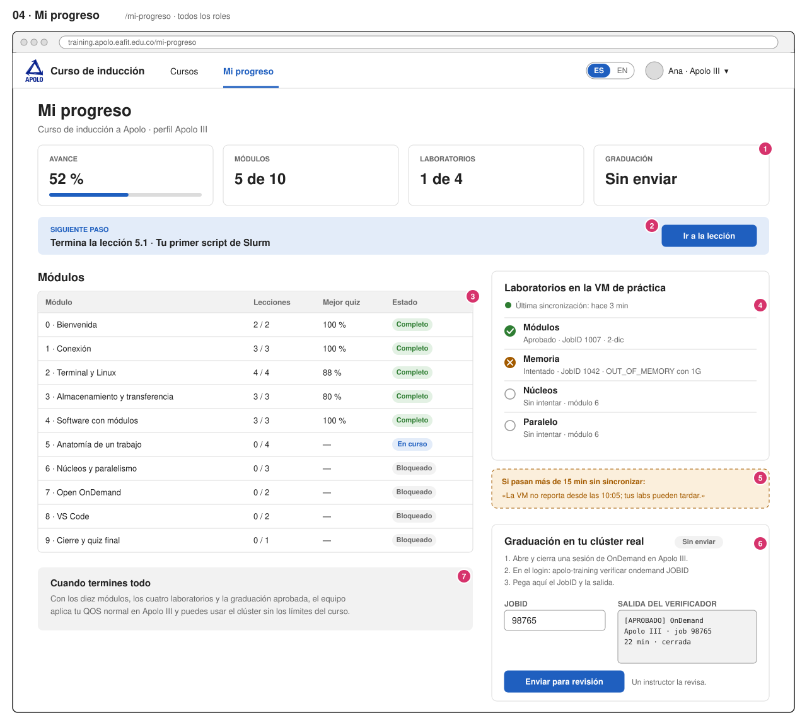
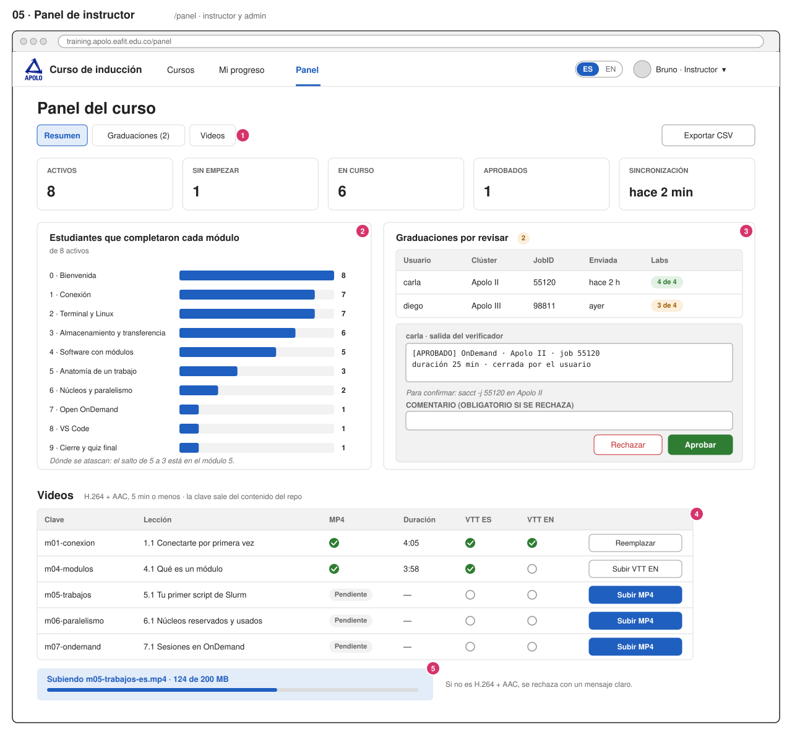
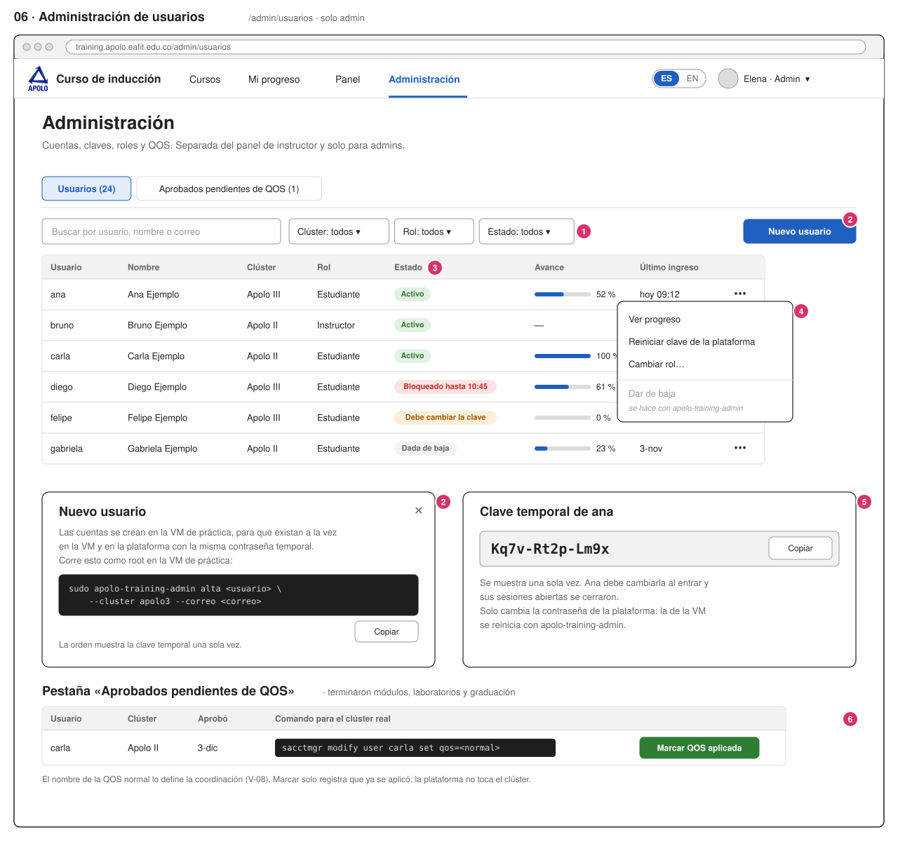

# Pantallas

Seis wireframes de baja fidelidad: definen qué hay en cada pantalla y de dónde
salen los datos, no los colores ni la tipografía (eso es la F-02). Los números
rosados de cada imagen se explican debajo. Los datos son de ejemplo y las
personas no existen.

Las rutas de la API van sin el prefijo `/api`, igual que en
[`api/openapi.yaml`](../../api/openapi.yaml).

Estado de ejemplo en todas las pantallas: Ana, perfil Apolo III, terminó los
módulos 0 a 4, va en el 5 y aprobó el laboratorio de módulos.

| #   | Pantalla                                                     | Ruta en la app                                      | Rol                |
| --- | ------------------------------------------------------------ | --------------------------------------------------- | ------------------ |
| 01  | [Inicio de sesión y primer ingreso](#01-inicio-de-sesión)    | `/ingresar`, `/cambiar-clave`                       | todos              |
| 02  | [Catálogo](#02-catálogo)                                     | `/cursos`, `/cursos/:curso`                         | todos              |
| 03  | [Lección](#03-lección)                                       | `/cursos/:curso/:modulo`, `…/:leccion`, `/terminal` | todos              |
| 04  | [Mi progreso](#04-mi-progreso)                               | `/mi-progreso`                                      | todos              |
| 05  | [Panel de instructor](#05-panel-de-instructor)               | `/panel`, `/panel/graduaciones`, `/panel/videos`    | instructor y admin |
| 06  | [Administración de usuarios](#06-administración-de-usuarios) | `/admin/usuarios`, `/admin/qos`                     | solo admin         |

**Desde la F-02, las capturas de [`capturas/`](capturas/) reemplazan a los
wireframes 02 y 03** (que todavía muestran 10 módulos, OnDemand y la terminal
quemada): catálogo, curso con sus módulos, módulo y lección, en celular y en
escritorio. La navegación quedó en cuatro niveles (catálogo → curso → módulo →
lección), cada uno con su página y sus migas de pan.

En celular (360 px o más, F-02) todas las pantallas pasan a una columna: la
barra lateral de la lección se vuelve un menú «Módulos», las tarjetas del
catálogo quedan de a una y las tablas del panel muestran solo usuario, estado y
acciones.

## 01 Inicio de sesión

**Desde la F-03, las capturas `capturas/f03-*.png` reemplazan a este
wireframe:** ingreso, clave errada, bloqueo y cambio de clave (primer ingreso y
voluntario), en celular y en escritorio.

1. **Usuario de su clúster.** El mismo de Apolo II o Apolo III. No hay registro
   propio: las cuentas las crea el equipo (ver [flujos](flujos.md#1-alta-de-una-cuenta)).
   La app lo manda en minúsculas y sin espacios.
2. **Errores con código.** La API responde `clave_incorrecta`,
   `cuenta_bloqueada` o `cuenta_inactiva` y la app arma el mensaje en el idioma
   elegido. Tras 5 intentos, bloqueo de 15 minutos (B-03). La pantalla **no dice
   cuántos intentos quedan** (eso delataría qué usuarios existen): muestra un
   aviso fijo, y con el bloqueo, la hora de desbloqueo en la hora local con la
   diferencia con UTC («3:42 p. m. GMT-5») y los minutos que faltan, para que
   alguien en otro país no se confunda.
3. **Sin recuperación por correo** en la v0: no hay correo saliente. Un
   instructor reinicia la clave desde el panel (pantalla 06).
4. **Idioma.** Antes de iniciar sesión se toma del navegador; después, del
   perfil (`PATCH /api/me`).
5. **Dos contraseñas.** Este aviso es la decisión más importante de la pantalla:
   la de la plataforma y la de la VM de práctica empiezan iguales y luego son
   independientes.
6. **Política:** 8 caracteres o más (128 como máximo), distinta de la temporal
   y del usuario. La validación se ve mientras se escribe; la API vuelve a
   validar (`clave_debil`, `clave_repetida`).
7. **Cambio voluntario.** «Cambiar contraseña» sigue en el menú de usuario
   (F-03): la misma pantalla pide la contraseña actual, tiene «Cancelar» y avisa
   que se cierran las sesiones en otros equipos.
8. **Sesión vencida.** Si la sesión no se puede renovar, la app vuelve aquí con
   «Tu sesión terminó» y, al entrar, regresa a la página donde estaba
   (`?volver=`, solo rutas de la app).

**API:** `POST /auth/login`, `POST /auth/cambiar-clave`, `GET /me`,
`PATCH /me` (idioma), `POST /auth/logout`.
**Estados:** cargando (botón deshabilitado), clave errada, cuenta bloqueada con
la hora de desbloqueo, cuenta dada de baja, sin conexión (VPN), sesión vencida.

## 02 Catálogo

1. **Perfil del clúster** visible desde la primera pantalla, porque decide qué
   pestaña se abre en las lecciones y cómo se ve la VM de práctica.
2. **Continuar** lleva a la lección donde quedó (`continuar` de
   `GET /cursos/{curso}`). Si no ha empezado, dice «Empezar».
3. **Catálogo.** Hoy hay un curso; la pantalla ya lista todos los publicados
   para no rehacerla cuando haya otro.
4. **Módulos bloqueados.** Se ven (título, duración, contenido) pero no se
   abren hasta completar el anterior. El laboratorio no bloquea: solo las
   lecciones. Instructores y admins sí los abren, para revisar el contenido,
   con un aviso de que los estudiantes los ven bloqueados.
5. **Qué trae cada módulo:** video, terminal quemada, laboratorio y número de
   preguntas, tal como en la tabla de módulos del plan.

**API:** `GET /cursos`, `GET /cursos/{curso}`, `GET /cursos/{curso}/modulos/{modulo}`
(por slug: `induccion`, `m05`).
**Estados:** sin empezar (sin barra «Continuar»), curso terminado (la barra
lleva a Mi progreso), la API no responde («No pudimos cargar el curso»).

## 03 Lección

**Desde la F-04, las capturas `capturas/f04-*.png` muestran el cuerpo de la
lección:** el texto con sus pestañas Apolo II / Apolo III (abre la del
perfil), los bloques de comandos con «Copiar» (las salidas dicen «salida» y no
se copian), el espacio del video («Video en preparación» mientras no se suba;
en la lección de VPN, uno por sistema operativo con el del navegador marcado),
«Verifica tu práctica», el quiz (F-06), «Marcar como completada» y
anterior / siguiente («Siguiente» hacia un módulo bloqueado no es enlace y dice
qué terminar). En inglés, una lección sin traducir sale en español con un
aviso. Las capturas usan la lección de muestra de las pruebas
(`web/src/testing/leccion-muestra.ts`), cargada como módulo 1.

- El Markdown no acepta HTML: si una lección lo trae, se ve como texto. Angular
  sanitiza además todo lo que pinta.
- «Marcar como completada» sale solo si no falta nada que la plataforma mida
  sola: la misma regla de la API (video subido visto al 90 % y quiz aprobado,
  si la lección los tiene). Con video o con quiz no hay botón (daría 409
  `requisitos_pendientes`): en su lugar una frase dice qué falta (ver el 90 %,
  aprobar el quiz o las dos cosas) y la lección se completa al cumplirlo. Un
  instructor puede leer un módulo bloqueado, pero no completarlo.

**Desde la F-06, el quiz vive en la lección** (debajo de «Verifica tu
práctica», sobre `GET /api/quizzes/{id}` y `POST /api/quizzes/{id}/intentos`).
Las capturas `capturas/f06-*.png` salen de la API real con el contenido de
`m00/bienvenida` y `m01/ssh`: el quiz en celular (360 px), el resultado en
celular y en escritorio, y la vista de solo lectura de una instructora:

- Todas las preguntas en una página. Cada una es un grupo con su número
  («Pregunta 2 de 8»), el enunciado (Markdown corto con código en línea y
  bloques) y una pista: «Elige una respuesta» (radios) o «Marca todas las que
  apliquen» (casillas). Las opciones son texto con Markdown en línea, sanitizado.
- Se aprueba con 80 %. La calificación es exacta: en una pregunta de varias
  respuestas, faltar una o marcar una de más la deja incorrecta (sin parciales).
- «Enviar respuestas» no se deshabilita: si faltan preguntas, dice cuáles y lleva
  el foco a la primera sin contestar; no se manda nada hasta que no falte ninguna.
- El resultado sale **arriba** con el foco (`role="status"`): aprobó o no, aciertos
  y porcentaje, el mejor puntaje y, si aprobó pero falta el video, qué falta
  para completar. Cada pregunta dice «Correcta» o «Incorrecta» (ícono y texto, no
  solo color) con su explicación; **nunca se revela la opción correcta**, para
  que reintentar sirva.
- Con el resultado a la vista las opciones quedan bloqueadas; «Intentar de nuevo»
  las reabre conservando lo marcado. Los intentos son ilimitados y el mejor
  puntaje no baja ni descompleta la lección.
- Un quiz ya aprobado dice «Ya aprobaste este quiz» y se puede repetir. En inglés,
  un quiz sin traducir sale en español con aviso. Si se cambia el idioma después
  de calificar, las explicaciones del resultado siguen en el idioma anterior hasta
  el próximo envío.
- Un instructor o administrador en un módulo bloqueado lee el quiz pero no lo
  envía (la API exige el módulo abierto): se ve de solo lectura y lo dice.
- Errores: si no carga, «No pudimos cargar el quiz · Reintentar» (el resto de la
  lección sigue a la vista); si no califica, mensaje y lo marcado se conserva; si
  la API dice `modulo_bloqueado`, se avisa y se pone al día el catálogo.

**Desde la F-05, las capturas `capturas/f05-*.png` muestran el reproductor:**
los controles del navegador (teclado, pantalla completa y celular funcionan
solos) y, debajo, la velocidad (0,75x a 2x) y los subtítulos (desactivados,
español o inglés). Con la interfaz en inglés los subtítulos en inglés vienen
prendidos y en español, apagados; lo que el usuario elija se recuerda en el
navegador para cada idioma, y cambiar ES/EN cambia la pista sin recargar el
video. Retoma donde iba («Seguiste donde ibas (2:00) · Ver desde el inicio»),
salvo al principio o si ya vio el 90 %. Reporta el segundo cada 15 s mientras
corre, al pausar y al salir; al 90 % la lección queda completa sin mover el
foco (lo anuncia a los lectores de pantalla). Si el video falla, por ejemplo
porque la sesión venció en una pausa larga, renueva la sesión y sigue en el
mismo segundo; si no puede, «No pudimos cargar el video · Reintentar». Las
capturas usan un video de prueba de 2 minutos en `m00/bienvenida`.

**A · Lección con video, lectura, terminal quemada y quiz**

1. **Qué falta para completarla.** Se arma con lo que trae la lección (ver
   [modelo de datos](modelo-datos.md#contenido)) y se marca solo a medida que
   se cumple.
2. **Video** con subtítulos ES/EN (en inglés por defecto si la interfaz está en
   inglés), velocidad de 0.75x a 2x y reanudación en el último segundo guardado.
   Reporta el avance cada 15 s (F-05).
3. **Pestañas Apolo II / Apolo III.** Abre la del perfil del usuario; la otra
   sigue disponible.
4. **Bloques de comandos** con botón «Copiar». El Markdown se sanitiza antes de
   mostrarse (F-04).
5. **Terminal quemada.** Ya no va: se quitó con el mapa del curso (A-12) y la
   práctica se hace en la VM de práctica (bloque B).
6. **Quiz** calificado en el servidor (F-06). Las opciones llegan sin la marca de
   la correcta.
7. **Resultado** con puntaje y la explicación de cada pregunta, sin revelar la
   opción correcta, para que reintentar sirva.
8. **Anterior y siguiente** dentro del curso. «Siguiente» respeta el bloqueo
   del módulo que sigue.
9. **Barra lateral** con todos los módulos, las lecciones del módulo actual y el
   avance del curso.

**B · Lección de laboratorio con la terminal real**

10. **Resultado del laboratorio** tal como llegó de la VM de práctica, con la
    hora de la última sincronización. «Intentado» con OUT_OF_MEMORY es lo
    esperado en el primer intento del laboratorio de memoria.
11. **Terminal real** hacia la VM de práctica, al lado de las instrucciones. Pide
    la contraseña de la VM (no la de la plataforma), muestra si está conectada,
    se puede abrir en otra pestaña y se cierra a los 15 min sin actividad o a las
    2 h (T-05, T-06). Va en la tarjeta «Verifica tu práctica» y no se conecta
    sola: «Abrir terminal». En otra pestaña es `/terminal`, la misma terminal a
    pantalla completa, que sí se conecta al entrar.

**API:** `GET /cursos/{curso}/lecciones/{modulo}/{leccion}`, `GET /media/{id}`, `GET /media/{id}/subtitulos/{idioma}`,
`POST /progreso/video`, `GET /quizzes/{id}`, `POST /quizzes/{id}/intentos`,
`POST /lecciones/{id}/completar` y el WebSocket
`/ws/terminal` ([flujo 3](flujos.md#3-terminal-real)).
**Estados:** video pendiente (aún no se ha subido), módulo bloqueado (403
`modulo_bloqueado`), terminal desconectada con el motivo y «Reconectar».

## 04 Mi progreso

1. **Cifras principales:** avance, módulos, laboratorios y graduación.
2. **Siguiente paso** calculado por la API (`siguiente_paso`): una lección, un
   laboratorio, la graduación o esperar la revisión.
3. **Módulos** con lecciones completas y el mejor puntaje del quiz.
4. **Laboratorios** de la VM de práctica: los cuatro siempre aparecen, aunque no
   se hayan intentado, con el JobID para que el usuario lo busque con `sacct`.
5. **Aviso de sincronización atrasada** cuando la última tiene más de 15
   minutos (F-07): el usuario sabe que el retraso no es suyo.
6. **Graduación.** El usuario pega el JobID y la salida del verificador de su
   clúster real; queda «Enviada» hasta que un instructor la revise. Si la
   rechazan, aquí se ve el comentario y puede reenviarla.
7. **Qué pasa al terminar.** La QOS normal la aplica un admin en el clúster real.

**API:** `GET /me/progreso`, `POST /me/graduacion`.
**Estados:** sin laboratorios intentados, graduación enviada, rechazada con
comentario, aprobada; curso aprobado esperando QOS; todo terminado.

**Desde la F-07, las capturas `capturas/f07-*.png` reemplazan a este
wireframe** (que todavía muestra cuatro laboratorios, OnDemand y diez módulos).
Salen de la API real con el contenido de `content/` y la VM simulada con
`POST /api/internal/labs`:

- Cuatro cifras (avance, módulos completos, prácticas aprobadas de siete y
  graduación) y el **siguiente paso** como acción principal: «Ir a la lección»
  para una lección o para la lección que explica una práctica (por el campo
  `practicas` de cada lección, F-07); «Ir a la graduación» lleva el foco a esa
  sección.
- **Módulos** como filas desplegables (`
`): lecciones completas y
  estado; adentro, cada lección con completa, video visto, el mejor puntaje del
  quiz y sus prácticas. Un estudiante no tiene enlace a las lecciones de un
  módulo bloqueado; instructores y admins sí.
- **Las siete prácticas** con estado, JobID, fecha, detalle y su lección. Arriba,
  la hora de la última sincronización y hace cuánto; con más de 15 minutos, el
  aviso de que el retraso no es del usuario. Si la VM nunca reportó, «todavía no
  ha enviado resultados», sin alarma.
- **Graduación:** sin enviar o rechazada, los pasos cortos para el clúster del
  perfil (`learning` en Apolo II, `bigmem` en Apolo III) y el formulario (JobID
  y salida, hasta 4000 caracteres), sin `@angular/forms`. Enviada, lo enviado y
  «Corregir envío»; rechazada, el comentario del instructor; aprobada, si falta
  la QOS. Un 409 `graduacion_aprobada` recarga y lo anuncia.
- La pantalla se recarga al cambiar el idioma, al volver a la pestaña, con
  «Actualizar» y tras enviar la graduación; «hace N min» y el aviso de los 15
  minutos se recalculan cada minuto.

## 05 Panel de instructor

1. **Pestañas.** «Resumen» junta lo que necesita acción; «Graduaciones» y
   «Videos» muestran lo mismo completo y con filtros. El panel es para el
   trabajo del curso; la gestión de cuentas está aparte, en «Administración»
   (pantalla 06), y un instructor no la ve. «Exportar CSV» baja el progreso de
   los estudiantes para la medición, también los dados de baja (B-08).
2. **Dónde se atascan:** cuántos estudiantes activos completaron cada módulo.
   Es el insumo de la medición del piloto (Q-06), junto con el CSV.
3. **Revisar una graduación:** salida del verificador, laboratorios aprobados y
   el comando para confirmarla en el clúster real. Rechazar exige comentario.
4. **Videos por clave** (`m01-conexion`…): la clave viene del front matter de la
   lección, así que el panel solo sube archivos; no asocia nada a mano.
5. **Subida con progreso** de hasta 2 GB. La API rechaza lo que no sea H.264 +
   AAC con un mensaje claro (B-05).

**API** (grupo `panel`, instructor y admin): `GET /panel/resumen`,
`GET /panel/graduaciones`, `POST /panel/graduaciones/{username}/revision`,
`GET /panel/videos`, `PUT /panel/videos/{clave}`,
`PUT /panel/videos/{clave}/subtitulos/{idioma}`, `GET /panel/export/progreso.csv`.

**Cómo quedó en la F-08 (27-nov).** Las capturas `capturas/f08-panel-*.png` reemplazan a este wireframe (que todavía muestra OnDemand, cuatro laboratorios y diez módulos):

- Las pestañas son rutas (`/panel`, `/panel/graduaciones`, `/panel/videos`) con
  `aria-current`; «Graduaciones» lleva la cuenta de las que esperan revisión.
  «Exportar CSV» elige el clúster (o todos), comprueba la sesión y baja el
  archivo.
- **Resumen** (`GET /panel/resumen`, F-08): activos, sin empezar (ninguna
  lección completa ni práctica aprobada), en curso, aprobados y hace cuánto
  sincronizó la VM; una barra por módulo con cuántos lo completaron y el
  módulo con el mayor salto («dónde se atascan»); y lo que espera una acción.
- **Graduaciones:** filtro por estado (por revisar, aprobadas, rechazadas o
  todas); al elegir una, la salida del verificador, cuántas prácticas tiene y
  el `sacct -D -j JOBID -u USUARIO` para confirmarla en su clúster. Rechazar
  sin comentario no llama a la API; un 409 (otra persona la revisó) recarga.
- **Videos:** una subida a la vez con barra de progreso y «Cancelar», por XHR
  (fetch no informa el progreso de subida); antes de reemplazar un archivo se
  pregunta; el navegador revisa la extensión y el tamaño (el formato real lo
  revisa la API) y la sesión se comprueba antes de empezar. Cada video enlaza
  a su lección para verlo con sus subtítulos.

## 06 Administración de usuarios

Sección separada del panel de instructor, con su propia entrada en el menú
(«Administración») que solo ven los admins. La API lo refuerza: todo lo que está
bajo `/api/admin` responde 403 a un instructor.

1. **Búsqueda y filtros** por clúster, rol y estado (activo, debe cambiar la
   clave, bloqueado, dado de baja).
2. **«Nuevo usuario» no crea la cuenta desde la web:** muestra la orden de
   `apolo-training-admin` para la VM de práctica. Así la cuenta existe en los
   dos lados o en ninguno.
3. **Estado** de la cuenta en la plataforma, para atender «no puedo entrar» sin
   abrir la base de datos. Es uno solo (dado de baja, bloqueado, debe cambiar
   la clave o activo, el primero que se cumpla) y la API lo da en `estado`
   (B-08). Reiniciar la clave también desbloquea la cuenta.
4. **Acciones por usuario:** ver su progreso (la pantalla 04 en modo lectura),
   reiniciar la clave de la plataforma y cambiar el rol. La baja se hace con
   `apolo-training-admin`.
5. **Clave temporal** que se muestra una sola vez. Recuerda que no cambia la
   contraseña de la VM.
6. **Aprobados pendientes de QOS:** quienes terminaron todo. La plataforma no
   toca el clúster real: muestra el comando y el admin marca cuando lo aplicó.

**API** (grupo `admin`, solo admin): `GET /admin/usuarios`,
`GET /admin/usuarios/{username}`, `PATCH /admin/usuarios/{username}`,
`POST /admin/usuarios/{username}/reiniciar-clave`,
`GET /admin/aprobados-pendientes`,
`POST /admin/aprobados-pendientes/{username}/qos-aplicada`.

**Cómo quedó en la F-08 (27-nov).** Las capturas `capturas/f08-admin-*.png` reemplazan a este wireframe:

- **Usuarios:** búsqueda (usuario, nombre o correo, tras una pausa de 300 ms),
  filtros nativos por clúster, rol y estado, 50 por página. Cada fila enlaza
  a la página del usuario y tiene un menú con «Ver su progreso», «Reiniciar
  clave de la plataforma» (deshabilitado con una baja) y «Cambiar rol…».
- **«Nuevo usuario»:** un formulario corto (usuario, nombre, correo, clúster e
  idioma) con las reglas de `apolo-training-admin` arma la orden
  `sudo apolo-training-admin alta …` con las comillas bien puestas; solo se
  muestra cuando todo está bien. La web no crea la cuenta.
- **Página del usuario** (`/admin/usuarios/:usuario`): los datos de la cuenta,
  las acciones y su Mi progreso en modo lectura (cifras, los módulos con el
  componente de la F-07, las siete prácticas y la graduación).
- **Reiniciar la clave** pregunta antes y muestra la clave una sola vez, en un
  diálogo que no se cierra con un clic afuera. **Cambiar el rol** explica el
  409 `ultimo_admin`; si un admin se quita su propio rol, se relee su perfil y
  sale de la administración.
- **Aprobados pendientes de QOS:** el comando para el clúster real con el
  marcador `<qos-normal>` (el nombre lo define la V-08; está en `QOS_NORMAL`
  de `features/admin/datos.ts`) y «Marcar QOS aplicada» con confirmación.
