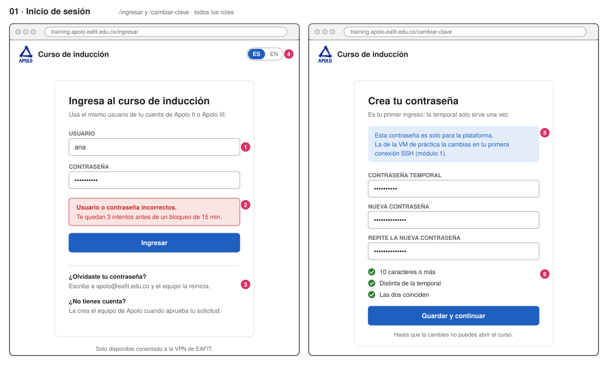
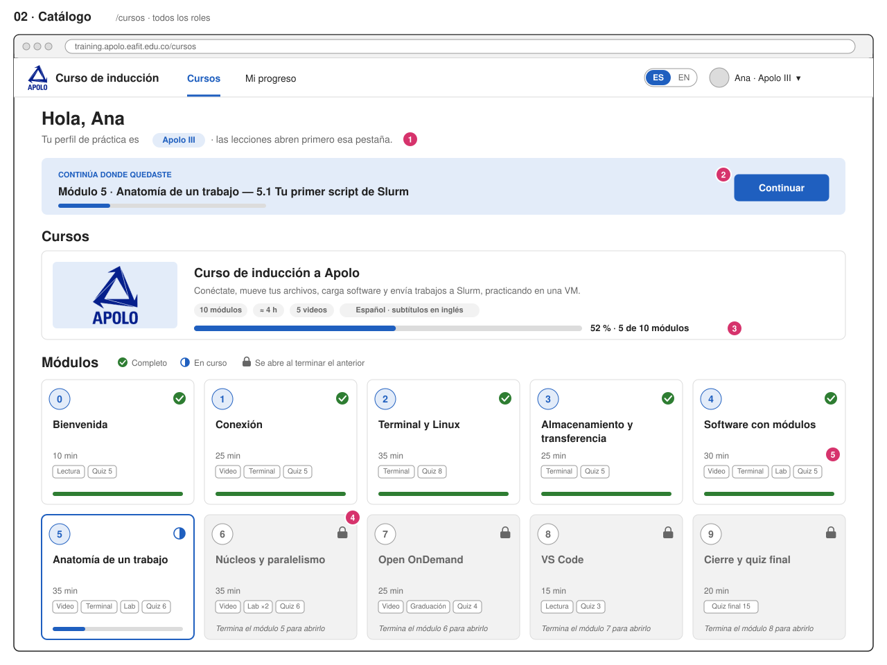
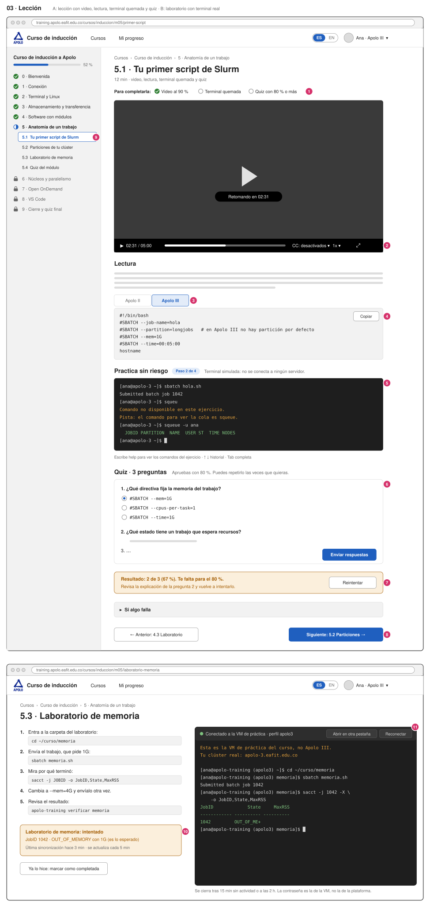
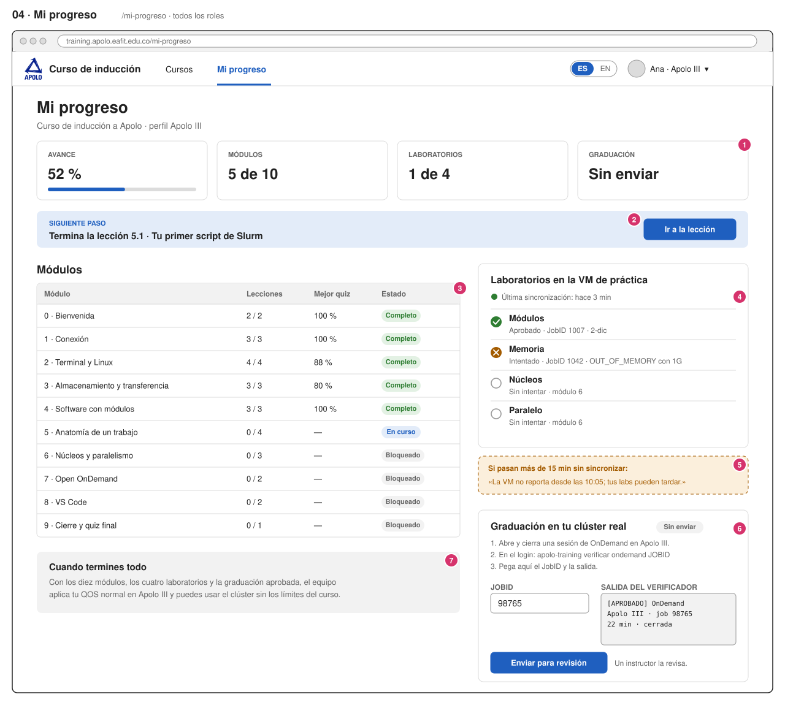
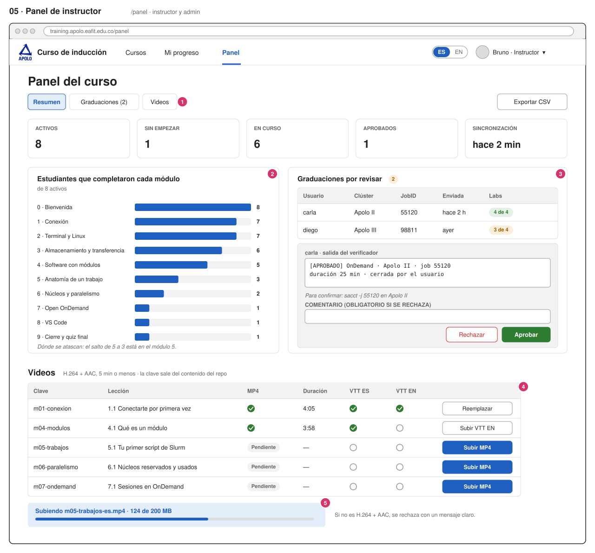
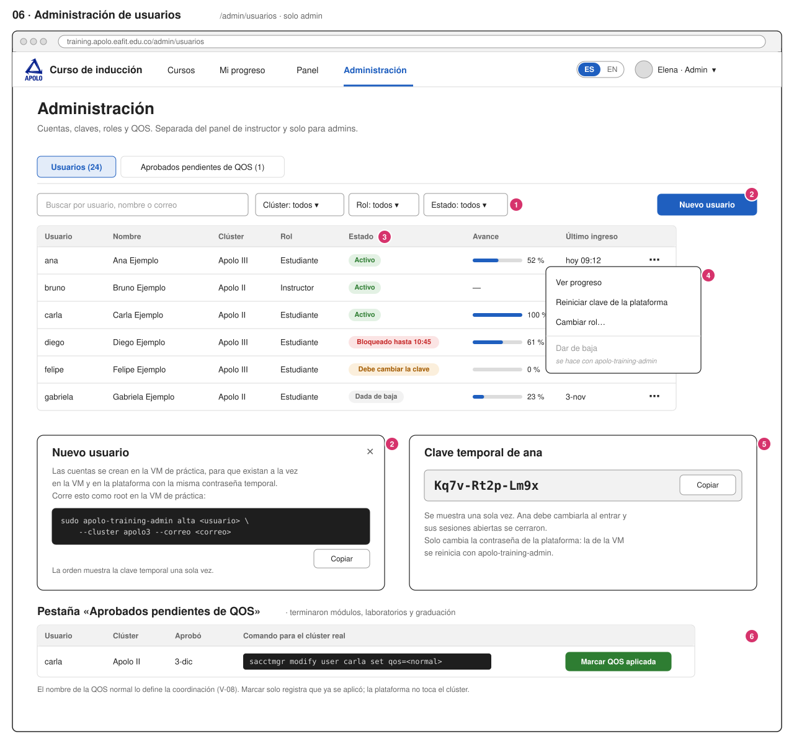

# Pantallas

Seis wireframes de baja fidelidad: definen qué hay en cada pantalla y de dónde
salen los datos, no los colores ni la tipografía (eso es la F-02). Los números
rosados de cada imagen se explican debajo. Los datos son de ejemplo y las
personas no existen.

Las rutas de la API van sin el prefijo `/api`, igual que en
[`api/openapi.yaml`](../../api/openapi.yaml).

Estado de ejemplo en todas las pantallas: Ana, perfil Apolo III, terminó los
módulos 0 a 4, va en el 5 y aprobó el laboratorio de módulos.

| #   | Pantalla                                                     | Ruta en la app                                   | Rol                |
| --- | ------------------------------------------------------------ | ------------------------------------------------ | ------------------ |
| 01  | [Inicio de sesión y primer ingreso](#01-inicio-de-sesión)    | `/ingresar`, `/cambiar-clave`                    | todos              |
| 02  | [Catálogo](#02-catálogo)                                     | `/cursos`, `/cursos/:curso`                      | todos              |
| 03  | [Lección](#03-lección)                                       | `/cursos/:curso/:modulo`, `…/:leccion`           | todos              |
| 04  | [Mi progreso](#04-mi-progreso)                               | `/mi-progreso`                                   | todos              |
| 05  | [Panel de instructor](#05-panel-de-instructor)               | `/panel`, `/panel/graduaciones`, `/panel/videos` | instructor y admin |
| 06  | [Administración de usuarios](#06-administración-de-usuarios) | `/admin/usuarios`, `/admin/qos`                  | solo admin         |

**Desde la F-02, las capturas de [`capturas/`](capturas/) reemplazan a los
wireframes 02 y 03** (que todavía muestran 10 módulos, OnDemand y la terminal
quemada): catálogo, curso con sus módulos, módulo y lección, en celular y en
escritorio. La navegación quedó en cuatro niveles (catálogo → curso → módulo →
lección), cada uno con su página y sus migas de pan.

En celular (360 px o más, F-02) todas las pantallas pasan a una columna: la
barra lateral de la lección se vuelve un menú «Módulos», las tarjetas del
catálogo quedan de a una y las tablas del panel muestran solo usuario, estado y
acciones.

## 01 Inicio de sesión

1. **Usuario de su clúster.** El mismo de Apolo II o Apolo III. No hay registro
   propio: las cuentas las crea el equipo (ver [flujos](flujos.md#1-alta-de-una-cuenta)).
2. **Errores con código.** La API responde `clave_incorrecta` o
   `cuenta_bloqueada` y la app arma el mensaje en el idioma elegido. Tras 5
   intentos, bloqueo de 15 minutos (B-03).
3. **Sin recuperación por correo** en la v0: no hay correo saliente. Un
   instructor reinicia la clave desde el panel (pantalla 06).
4. **Idioma.** Antes de iniciar sesión se toma del navegador; después, del
   perfil (`PATCH /api/me`).
5. **Dos contraseñas.** Este aviso es la decisión más importante de la pantalla:
   la de la plataforma y la de la VM de práctica empiezan iguales y luego son
   independientes.
6. **Política:** 10 caracteres o más, distinta de la temporal. La validación se
   ve mientras se escribe; la API vuelve a validar (`clave_debil`).

**API:** `POST /auth/login`, `POST /auth/cambiar-clave`, `GET /me`.
**Estados:** cargando (botón deshabilitado), clave errada, cuenta bloqueada con
la hora de desbloqueo, cuenta dada de baja.

## 02 Catálogo

1. **Perfil del clúster** visible desde la primera pantalla, porque decide qué
   pestaña se abre en las lecciones y cómo se ve la VM de práctica.
2. **Continuar** lleva a la lección donde quedó (`continuar` de
   `GET /cursos/{id}`). Si no ha empezado, dice «Empezar».
3. **Catálogo.** Hoy hay un curso; la pantalla ya lista todos los publicados
   para no rehacerla cuando haya otro.
4. **Módulos bloqueados.** Se ven (título, duración, contenido) pero no se
   abren hasta completar el anterior. El laboratorio no bloquea: solo las
   lecciones.
5. **Qué trae cada módulo:** video, terminal quemada, laboratorio y número de
   preguntas, tal como en la tabla de módulos del plan.

**API:** `GET /cursos`, `GET /cursos/{curso_id}`.
**Estados:** sin empezar (sin barra «Continuar»), curso terminado (la barra
lleva a Mi progreso).

## 03 Lección

**A · Lección con video, lectura, terminal quemada y quiz**

1. **Qué falta para completarla.** Se arma con lo que trae la lección (ver
   [modelo de datos](modelo-datos.md#contenido)) y se marca solo a medida que
   se cumple.
2. **Video** con subtítulos ES/EN (en inglés por defecto si la interfaz está en
   inglés), velocidad de 0.75x a 2x y reanudación en el último segundo guardado.
   Reporta el avance cada 15 s (F-05).
3. **Pestañas Apolo II / Apolo III.** Abre la del perfil del usuario; la otra
   sigue disponible.
4. **Bloques de comandos** con botón «Copiar». El Markdown se sanitiza antes de
   mostrarse (F-04).
5. **Terminal quemada.** Corre en el navegador con el escenario YAML de la T-01:
   pasos, pista después de dos errores, historial y Tab. Al terminar el último
   paso llama a `POST /progreso/terminal`.
6. **Quiz** calificado en el servidor. Las opciones llegan sin la marca de la
   correcta.
7. **Resultado** con puntaje y la explicación de cada pregunta, sin revelar la
   opción correcta, para que reintentar sirva.
8. **Anterior y siguiente** dentro del curso. «Siguiente» respeta el bloqueo
   del módulo que sigue.
9. **Barra lateral** con todos los módulos, las lecciones del módulo actual y el
   avance del curso.

**B · Lección de laboratorio con la terminal real**

10. **Resultado del laboratorio** tal como llegó de la VM de práctica, con la
    hora de la última sincronización. «Intentado» con OUT_OF_MEMORY es lo
    esperado en el primer intento del laboratorio de memoria.
11. **Terminal real** hacia la VM de práctica, al lado de las instrucciones. Pide
    la contraseña de la VM (no la de la plataforma), muestra si está conectada,
    se puede abrir en otra pestaña y se cierra a los 15 min sin actividad o a las
    2 h (T-05, T-06).

**API:** `GET /lecciones/{id}`, `GET /media/{id}`, `GET /media/{id}/subtitulos/{idioma}`,
`POST /progreso/video`, `POST /progreso/terminal`, `GET /quizzes/{id}`,
`POST /quizzes/{id}/intentos`, `POST /lecciones/{id}/completar` y el WebSocket
`/ws/terminal` ([flujo 3](flujos.md#3-terminal-real)).
**Estados:** video pendiente (aún no se ha subido), módulo bloqueado (403
`modulo_bloqueado`), terminal desconectada con el motivo y «Reconectar».

## 04 Mi progreso

1. **Cifras principales:** avance, módulos, laboratorios y graduación.
2. **Siguiente paso** calculado por la API (`siguiente_paso`): una lección, un
   laboratorio, la graduación o esperar la revisión.
3. **Módulos** con lecciones completas y el mejor puntaje del quiz.
4. **Laboratorios** de la VM de práctica: los cuatro siempre aparecen, aunque no
   se hayan intentado, con el JobID para que el usuario lo busque con `sacct`.
5. **Aviso de sincronización atrasada** cuando la última tiene más de 15
   minutos (F-07): el usuario sabe que el retraso no es suyo.
6. **Graduación.** El usuario pega el JobID y la salida del verificador de su
   clúster real; queda «Enviada» hasta que un instructor la revise. Si la
   rechazan, aquí se ve el comentario y puede reenviarla.
7. **Qué pasa al terminar.** La QOS normal la aplica un admin en el clúster real.

**API:** `GET /me/progreso`, `POST /me/graduacion`.
**Estados:** sin laboratorios intentados, graduación enviada, rechazada con
comentario, aprobada; curso aprobado esperando QOS; todo terminado.

## 05 Panel de instructor

1. **Pestañas.** «Resumen» junta lo que necesita acción; «Graduaciones» y
   «Videos» muestran lo mismo completo y con filtros. El panel es para el
   trabajo del curso; la gestión de cuentas está aparte, en «Administración»
   (pantalla 06), y un instructor no la ve. «Exportar CSV» baja el progreso de
   todos para la medición.
2. **Dónde se atascan:** cuántos estudiantes activos completaron cada módulo.
   Es el insumo de la medición del piloto (Q-06), junto con el CSV.
3. **Revisar una graduación:** salida del verificador, laboratorios aprobados y
   el comando para confirmarla en el clúster real. Rechazar exige comentario.
4. **Videos por clave** (`m01-conexion`…): la clave viene del front matter de la
   lección, así que el panel solo sube archivos; no asocia nada a mano.
5. **Subida con progreso** de hasta 2 GB. La API rechaza lo que no sea H.264 +
   AAC con un mensaje claro (B-05).

**API** (grupo `panel`, instructor y admin): `GET /panel/resumen`,
`GET /panel/graduaciones`, `POST /panel/graduaciones/{username}/revision`,
`GET /panel/videos`, `PUT /panel/videos/{clave}`,
`PUT /panel/videos/{clave}/subtitulos/{idioma}`, `GET /panel/export/progreso.csv`.

## 06 Administración de usuarios

Sección separada del panel de instructor, con su propia entrada en el menú
(«Administración») que solo ven los admins. La API lo refuerza: todo lo que está
bajo `/api/admin` responde 403 a un instructor.

1. **Búsqueda y filtros** por clúster, rol y estado (activo, debe cambiar la
   clave, bloqueado, dado de baja).
2. **«Nuevo usuario» no crea la cuenta desde la web:** muestra la orden de
   `apolo-training-admin` para la VM de práctica. Así la cuenta existe en los
   dos lados o en ninguno.
3. **Estado** de la cuenta en la plataforma, para atender «no puedo entrar» sin
   abrir la base de datos.
4. **Acciones por usuario:** ver su progreso (la pantalla 04 en modo lectura),
   reiniciar la clave de la plataforma y cambiar el rol. La baja se hace con
   `apolo-training-admin`.
5. **Clave temporal** que se muestra una sola vez. Recuerda que no cambia la
   contraseña de la VM.
6. **Aprobados pendientes de QOS:** quienes terminaron todo. La plataforma no
   toca el clúster real: muestra el comando y el admin marca cuando lo aplicó.

**API** (grupo `admin`, solo admin): `GET /admin/usuarios`,
`GET /admin/usuarios/{username}`, `PATCH /admin/usuarios/{username}`,
`POST /admin/usuarios/{username}/reiniciar-clave`,
`GET /admin/aprobados-pendientes`,
`POST /admin/aprobados-pendientes/{username}/qos-aplicada`.
